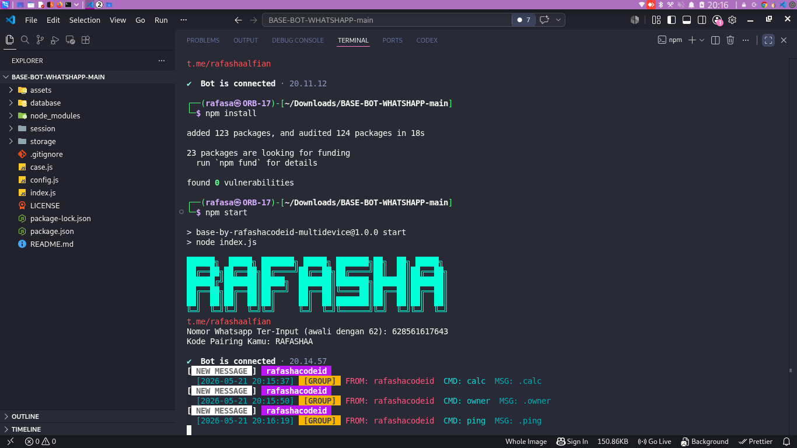

# 🤖 rafashacodeid WhatsApp Bot Base

A lightweight WhatsApp automation foundation that ships with secure defaults, clean code, and just enough commands to stay focused. This multi-device bot keeps a single session in sync across linked devices and powers a `ping` health check, an inline calculator, and owner contact helpers for small groups or personal assistants.

## 🔧 Highlights

- ✅ Basic but reliable WhatsApp connection via `@whiskeysockets/baileys`
- 🧪 Commands kept minimal: `.ping`, `.calc <formula>`, and `.owner`
- 🎨 Connection logging now prints a compact, colored “Bot is connected” card
- 🌀 Easy to extend when you need more commands or integrations

---

 ## 📸 Preview

<p align="center">
    
</p>

---

## 🚀 Quick start

```bash
git clone https://github.com/rafashaalfiandi/BASE-BOT-WHATSHAPP.git
cd BASE-BOT-WHATSHAPP
npm install
npm start
```

Ensure `config.js` is populated with your WhatsApp/owner details before running the bot.

## 🛎️ Available commands

- `.ping` — replies with latency, system info, and a colored preview card.
- `.calc <expr>` — evaluates simple arithmetic expressions (`+`, `-`, `*`, `/`, parentheses).
- `.owner` — shares the configured owner name and WA link with the requester.

These commands are designed for quick checks and owner lookups; extend `case.js` if you need group utilities or more interactive flows.

## 📬 Contact

Need help or want to collaborate?

- GitHub: [rafashaalfiandi](https://github.com/rafashaalfiandi)
- Instagram: [rafashacode.id](https://instagram.com/rafashacode.id)
- Telegram: [rafashaalfiandi](https://t.me/rafashaalfiandi)
- Email: [rafashacode.id@gmail.com](mailto:rafashacode.id@gmail.com)

## ⚖️ License

MIT © Rafashacode.id
